# 研发加计资料生成（流程A规范版）

将原始研发资料整理为一套可复核、口径一致、可用于留存备查的研发加计项目资料。本 skill 是**流程A规范**的第一个验证载体：内容与 `generate-rd-deduction-report` 等价，编排形态改为“流程图即流程”，可直接作为流程编译器的输入。

## 发布包与资源路径

- 发布时保留本目录的 `SKILL.md`、`references/`、`scripts/`、`templates/` 和 `requirements.txt`。
- `scripts/`、`templates/`、`references/` 相对本 skill 目录，只作资源读取；`facts.json`、`work/` 与验证材料相对本次运行目录。运行目录默认 `<主工作区>/.agent-artifacts/<任务>/<唯一运行标识>/`，Git 用登记的主 checkout，非 Git 用项目目录。首次创建前在该工作区 `.gitignore` 加入 `/.agent-artifacts/` 并用 `git check-ignore` 核验，非 Git 跳过。调用脚本时将这些路径展开为绝对路径，不向 skill 安装目录写运行产物。
- 运行环境为 Python 3.10 或更新版本；在隔离环境中执行 `pip3 install -r requirements.txt` 安装 Python 依赖。
- 语义纪律见 `references/workflow.md`、`references/rules.md`、`references/document-templates.md`、`references/workbook-template.md` 和 `references/json-input.md`；形式规则以 `templates/rules.json` 为准。
- 脚本与模板随本 skill 一起发布。Python 依赖列在 `requirements.txt`；`--ocr` 需要额外安装 Tesseract 及 `chi_sim`、`eng` 语言数据，`--render-dir` 需要 LibreOffice。
- 产物清单与文件名结构不变：`output/研发加计/<项目名称>/` 下 00 底稿、01–03 三份 DOCX、04 补充清单；`output/` 映射到用户指定的正式交付目录。`facts.json`、`work/state.jsonl`、对应表裁定与图片证据需跨轮次保留，不随重跑清理。仅可复算副本使用本会话临时目录，清理不越出本次创建的专属目录。
- 本 skill 描述的是**独立 Agent 执行**语义（核验或冲突处理后可回到底稿重跑）。转换为 EY TIMP ETL 时，返工回边按所选编译策略执行；采用 `--rework-as=fail_edge` 时，返工状态落库后**终止链路**，需人工修正后重触发。

## 流程A（编排唯一信源）

拓扑只准在图里改，契约只准在块里改：路由字段必须被图引用，状态通道只进块、不进分支。

```mermaid
flowchart TD
    start(["输入：材料目录 + 最终研发文档目录 + 公司/年度/项目范围/batch"]):::io

    batchq{"batch == true?"}:::cond
    corr["整理材料归属与待确认事项 JSON：work/correspondence-data.json"]:::model
    corr_ready{"correspondence_ready == true?"}:::cond
    corrxlsx["生成对应表与待确认事项清单：generate_correspondence_workbook.py"]:::script
    audit[["用户审核对应表"]]:::human
    corrq{"corr_status 审核状态?"}:::cond

    inventory["盘点入库：资料清单登记"]:::model
    route{"file_type 路由"}:::cond
    fxls[".xls：extract_office_layers.py（xlrd）"]:::script
    fdoc[".doc 二进制分类：extract_doc_layers.py --classify-only"]:::script
    docq{"doc_forensic_result?"}:::cond
    docext["按文字层或图片层抽出内容"]:::script
    docread["解读抽取结果并入 facts"]:::model
    docdmg["登记损坏证据，索取原件<br/>清单留痕（不进正文）"]:::gate
    fimgx["图片取证分级（document/photo）"]:::script
    fimg{"image_class?"}:::cond
    imgext["出图/元数据：extract_images.py"]:::script
    imgdoc["文档类图片：解读抽取结果并入 facts，核对留痕"]:::model
    imgphoto["照片类：解读抽取结果并归类入 facts"]:::model
    frext["DOCX/XLSX/PDF/TXT：常规格式抽出文本/表"]:::script
    fread["解读抽取结果并入 facts"]:::model
    facts[("facts.json：每条事实带 source_file + location")]:::data

    normalize["JSON 归一化：data_model.py --input facts.json --output work/normalized.json"]:::script
    rulecheck["形式规则校验：rule_engine.py --input facts.json --projection work/normalized.json"]:::script
    paper["建立统一底稿：字段四态标注 + 冲突登记"]:::model
    dateq{"date_precision == month?"}:::cond
    hxxdate["年月入底稿，具体日落 Hxx（正文占位）"]:::gate
    conflict{"conflict_flag != none?"}:::cond
    hxx["落【待核对：Hxx】（正文占位）<br/>双方来源值入底稿"]:::gate
    ruleq{"user_ruling_given == true?"}:::cond
    ruling[["冲突裁决门禁：用户裁定，关联字段一并处理"]]:::human
    compliance["合规边界检查：疑点入底稿与补充清单"]:::model
    project["文档投射：三份客户版文档 JSON"]:::model
    prereq{"unresolved_conflicts == false?"}:::cond
    render["模板渲染：generate_rd_docs.py"]:::script
    vcheck["渲染核验：verify_rd_docs.py"]:::script
    verify{"verify_passed == true?"}:::cond
    summary["条件跨项目汇总：generate_supplement_summary.py"]:::script
    done(["交付：00 底稿、01–03 DOCX、04 补充清单"]):::io

    start --> batchq
    batchq -->|"true"| corr --> corr_ready
    corr_ready -->|"true"| corrxlsx --> audit --> corrq
    corr_ready -->|"false"| corr
    corrq -->|"audited"| inventory
    corrq -->|"pending"| corr
    batchq -->|"false"| inventory
    inventory --> route
    route -->|"xls"| fxls --> facts
    route -->|"doc"| fdoc --> docq
    docq -->|"readable 或 image_only"| docext --> docread --> facts
    docq -->|"damaged"| docdmg --> facts
    route -->|"jpg/png"| fimgx --> fimg
    fimg -->|"document"| imgext --> imgdoc --> facts
    fimg -->|"photo"| imgext --> imgphoto --> facts
    route -->|"docx/xlsx/pdf/txt"| frext --> fread --> facts
    facts --> normalize --> rulecheck --> paper
    paper --> dateq
    dateq -->|"true"| hxxdate --> conflict
    dateq -->|"false"| conflict
    conflict -->|"true"| hxx --> ruleq
    conflict -->|"false"| compliance
    ruleq -->|"true"| ruling --> paper
    ruleq -->|"false"| paper
    compliance --> project --> prereq
    prereq -->|"false"| hxx
    prereq -->|"true"| render --> vcheck --> verify
    verify -->|"false"| paper
    verify -->|"true"| summary --> done

    classDef model fill:#f96,stroke:#333,color:#000;
    classDef script fill:#9cf,stroke:#333,color:#000;
    classDef human fill:#c9f,stroke:#333,color:#000;
    classDef gate fill:#fd3,stroke:#333,stroke-dasharray:5,color:#000;
    classDef cond fill:#fff,stroke:#333,color:#000;
    classDef data fill:#dfd,stroke:#333,color:#000;
    classDef io fill:#eee,stroke:#999,color:#000;
```



```yaml
flow: rd-deduction-report
version: 5
scope: 单项目粒度。本图没有 loop 节点，不生成循环。batch 只是图内布尔分支，不是循环声明。
inputs: [原始研发材料目录, 最终研发文档目录, {公司, 年度, 项目范围, batch}]
artifacts:
  correspondence_data: work/correspondence-data.json
  templates: templates/report.json
  rules: templates/rules.json
  scripts:
    fxls: scripts/extract_office_layers.py  # .xls：xlrd 抽层
    normalize: scripts/data_model.py
    rulecheck: scripts/rule_engine.py
    render: scripts/generate_rd_docs.py
    vcheck: scripts/verify_rd_docs.py
    summary: scripts/generate_supplement_summary.py
    corrxlsx: scripts/generate_correspondence_workbook.py
    fimgx: scripts/extract_images.py  # --classify：输出 image_class
    fdoc: scripts/extract_doc_layers.py  # --classify-only：输出 doc_forensic_result
    imgext: scripts/extract_images.py   # 出图/元数据（document/photo 共用）
    docext: scripts/extract_doc_layers.py
    frext: scripts/extract_office_layers.py
outputs:
  - output/研发加计/<项目名称>/00-研发加计工作底稿.xlsx
  - output/研发加计/<项目名称>/01-立项决议.docx
  - output/研发加计/<项目名称>/02-项目计划书.docx
  - output/研发加计/<项目名称>/03-成果效用说明.docx
  - output/研发加计/<项目名称>/04-补充信息清单.xlsx
  - output/研发加计/对应表与待确认事项清单.xlsx  # batch == true 时产出，audit 通过后定稿
  - output/补充信息汇总清单.xlsx  # batch == true 时产出
fields:
  batch: {type: bool, emitted_by: 输入}
  correspondence_ready: {type: bool, emitted_by: corr, note: true 表示材料映射与 questions 数据齐备，可渲染审核工作簿}
  file_type: {type: enum, values: [xls, doc, docx, xlsx, pdf, txt, jpg, png], emitted_by: inventory}
  image_class: {type: enum, values: [document, photo], emitted_by: fimgx, note: inventory 可按文件名语义预判，以 fimgx 判定为准}
  doc_forensic_result: {type: enum, values: [readable, image_only, damaged], emitted_by: fdoc}
  date_precision: {type: enum, values: [day, month], emitted_by: "fxls/docread/imgdoc/fread"}
  conflict_flag: {type: enum, values: [none, name, date, amount, entity_name, other], emitted_by: paper}
  user_ruling_given: {type: bool, emitted_by: 用户, note: ruleq 求值时提供；true 表示用户对本批冲突给出裁定，升级 ruling 覆盖 Hxx}
  corr_status: {type: enum, values: [pending, audited], emitted_by: audit}
  unresolved_conflicts: {type: bool, emitted_by: paper, note: 每轮冲突处理后更新}
  verify_passed: {type: bool, emitted_by: vcheck}
channels:
  facts.verification_status: {type: enum, values: [confirmed, pending_check], emitted_by: "imgext/imgdoc", note: 图片类事实 imgext 出图时记 pending_check，imgdoc 逐张核对后升级 confirmed；photo 分支保持 pending_check（未逐张核对）；状态通道，cond 不得引用}
  supplements.channel: {type: enum, values: [word, list], emitted_by: "hxxdate/hxx/docdmg", note: word=正文占位（分配 Hxx）；list=清单留痕（不进正文）；状态通道，cond 不得引用}
states:
  binding_line:
    envelope: [state, entity, flow_instance, chain_code, source_node, blocking, status_value, ts]
    note: >-
      行 = envelope + 本行所属 state 的 fields（可顶层可 payload 内）+ payload 自由键（逐字进 JSON 列，保证行可逆）。
      顶层非 envelope 键必须属于某个 state 声明的 fields，且值对非本行 state 的字段为 null。
      轻量绑定（state.jsonl 行）与 ETL 绑定（DB 行）同源于本声明，不得有声明之外的信息差。
  corr_review:
    field: corr_status
    entity: 对应表审核
    names: {pending: 待审核, audited: 已审核}
    producer: audit
    consumer: corrq
    changed_by: 人工（ETL 外审核对应表后改状态）
    blocking: true
  supplement_item:
    entity: 补充信息条目
    fields: [channel, supplement_id, source_fact, desc, docs, dept, prio, word_ref]
    channel_field: supplements.channel
    producers: [hxxdate, hxx, docdmg]
    projection: 04-补充信息清单.xlsx（人读投影，机器视图是 state.jsonl / 状态表）
    changed_by: 人工（补料完成后勾选）
    blocking: false
  conflict_resolution:
    field: unresolved_conflicts
    entity: 冲突裁决
    names: {true: 有未决冲突, false: 全部已落 Hxx 或已裁定}
    producers: [paper, ruling]
    consumer: prereq
    blocking: true
    note: 落 Hxx 解决的一轮由 ruleq(false) 回 paper 重算底稿承载——hxx 只写 supplement_item，不兼报本状态；paper 重评 conflict_flag=none 且 unresolved_conflicts=false 后正向收敛到渲染
  render_verify:
    field: verify_passed
    entity: 渲染核验
    names: {false: 待返工}
    producer: vcheck
    consumer: verify
    blocking: true
acceptance:
  - 每个字段有来源或 Hxx（内容检查）
  - 目标、方案、里程碑、成果相互对应（逻辑检查）
  - 研发实质、排除活动、费用归集、备查资料合规（合规检查）
  - 公共字段、时间、金额、人员、成果、编号交叉一致（交叉检查）
  - 三份 DOCX 恰好三条技术主线，每条含六项方案内容
  - 正文占位级 Hxx：Word 与补充清单完全一致，无孤立或重复编号；清单留痕项仅在补充清单登记，不进正文
  - 逐页渲染检查通过，文件名、页码、占位符集合、输出目录正确（依赖分页工具链；无分页能力时降级为结构核验并在交付时声明）
policies:
  - 用户来源材料默认混乱：格式解码与抽层用 script，语义理解与入 facts 用 model；模型只产出对应表的结构化数据，脚本负责渲染对应表与待确认事项工作簿；其他结构规整产物（底稿、三份 DOCX、补充清单、汇总）也由脚本读写、渲染和核验。读图同构：fimgx 取证分级 → imgext（extract_images.py）出图/元数据 → imgdoc/imgphoto 语义入 facts（与 docext/docread、frext/fread 一致）
  - 冲突默认出口是落 Hxx；user_ruling_given == true 时升级为用户裁定；unresolved_conflicts == false 才允许渲染（prereq 硬门）
  - 清单留痕项使用 Lxx、不分配 Hxx、不进客户版正文；渲染脚本将 word 项写入工作底稿和 04 补充清单，将 list 项只写入 04 补充清单；DOCX 模板只接收 word 通道，核验脚本只校验 word 通道的 Hxx 集合与顺序，不修改产物
  - 核验通过后调用汇总脚本；仅 batch == true 时生成跨项目汇总清单，否则脚本返回 skipped 且不创建文件
  - 用户裁定只覆盖裁定明确涉及的字段，不自动扩展；同冲突源关联呈现一并处理
  - 不确定一律落 Hxx，不杜撰日期、金额、编号
  - 正文不得含评分、风险等级、证据链评分或内部控制语言
  - 无分页能力时 supplements.pages 填符合 `templates/rules.json` 页码格式的占位值，并在交付说明中声明实际未分页（不得填违反 `scripts/rule_engine.py` 中 PAGE_RE 的值）
```

## 流程A铁律

1. **图管拓扑，块管契约**：增删节点或边只改 mermaid；字段、契约、门槛只改 yaml。交叉校验：路由字段必须在图中被某条 cond 出边引用，状态通道不要求出现在图中；图中每个节点在块的 fields、channels、states 或 artifacts 中必须有出处（human/gate 的出处即 states 的 producer 声明）。违反即编译错误。
2. **分支只读路由字段**：cond 出边只能引用 `fields:` 声明的字段做路由，成对完备、枚举全覆盖；引用状态通道或未声明字段即编译错误。cond 节点标签声明求值字段与风格：含 `==`/`!=` 为判定式风格（出边用 true/false，取标签判定式或其否定）；不含运算符为取值路由风格（出边用枚举值，`或` 或 `/` 分隔，枚举须全覆盖）。
3. **classDef 即执行者声明**：节点必须带 `model/script/human/gate/cond/data/io` 之一，缺 class 即编译错误。模型节点只产出契约声明的输出，不现场决定流程走向；开放判断收敛为闭合枚举字段，“不确定”一律路由到 human/gate。
4. **待办双通道**：gate 类节点产出的待办必须经 `supplements.channel` 区分正文占位（word，分配 Hxx）与清单留痕（list，不进正文）；留痕项不得为满足 acceptance 第六条硬塞正文占位。
5. **acceptance 是交付门槛**：渲染后逐条核验，任一不过即回到 paper 修正后重渲染。
6. **人工语义只在 `states:` 声明**：每个 human/gate 节点必须且只能是一个 state 的 producer，阻断性只来自 state 的 `blocking:` 声明，不得按节点类名推断。独立运行时用轻量绑定（`work/state.jsonl` 每触发一行，blocking=true 停下等用户）；ETL 运行时由编译器按同一份声明生成 DB 绑定，两种绑定不得有声明之外的信息差。
7. **循环只在图中声明**：批量循环必须画成 `:::loop` 节点，直接上游是参数整理节点，下游是循环体。scope 或其他自然语言不产生循环。图中没有 loop 节点，转换不生成循环。

## 执行工作流

1. 从本目录读取 `references/` 下五份规则文件和 `templates/rules.json`。
2. 按流程A逐个执行模型节点：每节点产出契约声明的 JSON，事实与写作纪律以 `references/rules.md` 为准；脚本节点调用本目录 `scripts/` 下的固定脚本，输入协议见 `references/json-input.md`。
3. cond 节点只对 `fields:` 路由字段求值；`channels:` 是节点内部状态，不得用于分支。遇到块中未声明的情况，先回块里补声明再执行，不得在执行中临时扩展字段。
4. human/gate 节点落成显式待办：独立运行时在 `work/state.jsonl` 追加一行状态记录（state=对应 state 名、producer 节点、blocking、业务字段），blocking=true 的节点记完日志后停下等用户裁定，人到场后推进并在底稿留痕；gate 待办另标明 channel（word 分配 Hxx / list 仅登记）。用户裁定只覆盖裁定明确涉及的字段，不自动扩展；同冲突源关联呈现一并处理，不得让被裁定一侧的值以其他字段形式残留正文。
5. render 前确认 prereq 为 true（unresolved_conflicts == false）；渲染后调用 `scripts/verify_rd_docs.py` 核验 Hxx 集合与首次出现顺序。脚本输出 `verify_passed == true` 后，按 acceptance 七条逐条核验，全部通过才交付。
6. 批量场景（batch == true）必须先走对应表审核门：模型将材料映射与待确认事项写入 `work/correspondence-data.json`，并声明 `correspondence_ready`；为 false 时补全后重跑，为 true 时调用 `scripts/generate_correspondence_workbook.py` 生成审核工作簿。`corr_status == audited` 才进入盘点入库。本图没有 loop 节点，不生成多项目循环。要逐项目循环，必须另画 loop 节点及其直接上游的参数整理节点。核验通过后调用 `scripts/generate_supplement_summary.py`；仅 batch 场景传入 `--batch` 与所有项目 facts JSON，生成跨项目汇总清单，单项目调用时脚本返回 skipped 且不创建文件。
