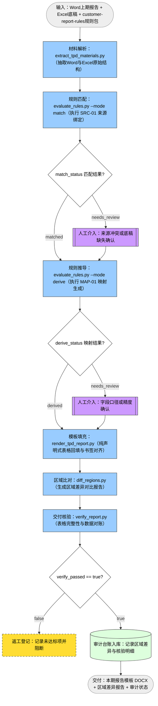

# 转让定价（TPD）报告模板生成（流程A规范版）

将企业上期 Word 报告与本期转让定价工作底稿（Workingpaper Excel）在业务规则 Skill（如 `customer-report-rules`）指导下自动匹配、映射并渲染为本期报告模板，同时输出精准的区域级差异比对。

本 Skill 完全遵循**流程A规范**：
1. **解析完全由内部 Python 脚本承载**：使用 `extract_tpd_materials.py` 对 Word 与 Excel 执行物理结构抽取与格式解码，不依赖 Java/POI 硬编码；
2. **业务规则外置解耦**：表与 Sheet 的来源匹配（SRC-01）和列映射格式规则（MAP-01）由独立的业务规则包声明；
3. **流程即拓扑**：可无损编译为 LiteFlow BPMN 与状态表 DDL，输入 `ey-timp-etl` 平台执行。

## 流程A（编排唯一信源）



```yaml
flow: generate-tpd-report
version: 1
scope: 单报告粒度；以 Word 上期报告与 Excel 底稿为单位生成本期报告模板
inputs: [上期Word报告路径, 工作底稿Excel路径, 业务Skill规则包路径]
artifacts:
  scripts:
    extract: scripts/extract_tpd_materials.py
    match: scripts/evaluate_rules.py
    derive: scripts/evaluate_rules.py
    render: scripts/render_tpd_report.py
    diff: scripts/diff_regions.py
    vcheck: scripts/verify_report.py
outputs:
  - output/<报告名称>_本期模板.docx
  - output/<报告名称>_区域差异报告.json
  - output/<报告名称>_审计日志.json
fields:
  match_status: {type: enum, values: [matched, needs_review], emitted_by: match}
  derive_status: {type: enum, values: [derived, needs_review], emitted_by: derive}
  verify_passed: {type: bool, emitted_by: vcheck}
channels:
  regions.channel: {type: enum, values: [table, paragraph], emitted_by: extract, note: 区域类型通道，cond不得引用}
states:
  binding_line:
    envelope: [state, entity, flow_instance, chain_code, source_node, blocking, status_value, ts]
    note: 轻量绑定（state.jsonl）与平台 DB 状态表同源，行逐字可逆。
  match_audit:
    field: match_status
    entity: 来源匹配审核
    names: {matched: 匹配通过, needs_review: 待人工确认}
    producer: match_audit
    consumer: match_gate
    changed_by: 人工（在审阅台确认来源工作表）
    blocking: true
  derive_audit:
    field: derive_status
    entity: 映射规则审核
    names: {derived: 推导通过, needs_review: 待人工确认}
    producer: derive_audit
    consumer: derive_gate
    changed_by: 人工（在审阅台确认字段映射口径）
    blocking: true
  rework_audit:
    field: verify_passed
    entity: 渲染核验返工
    names: {false: 校验不通过待返工}
    producer: rework
    consumer: verify_gate
    changed_by: 人工（排查格式或底稿后重跑）
    blocking: true
acceptance:
  - 所有待填充表格均有来源 Sheet 对应或显式标记 needs_review
  - 字段映射符合业务 Skill 声明，金额列保留两位小数，零值显示为 -
  - Base 稿与 Template 稿具备完全对齐的书签锚点（TPL_TR_xxxxxx）
  - 区域差异对比报告覆盖全部标注区域，无结构丢失
  - 产出符合 DOCX 规范，可在各类 Web 编辑器（Collabora / OnlyOffice）中无损打开
policies:
  - 格式解析直接使用 Skill 中的 Python 脚本执行，严禁在 Java/ETL 引擎中编写特定格式或业务抽取逻辑
  - 业务规则完全由外部业务 Skill（customer-report-rules 等）提供，主流程保持通用无业务硬编码
  - 匹配或映射不确定时必须给出 needs_review，阻断至人工门禁，杜绝伪造乘数（禁止使用 1.085 等假数据）
```
